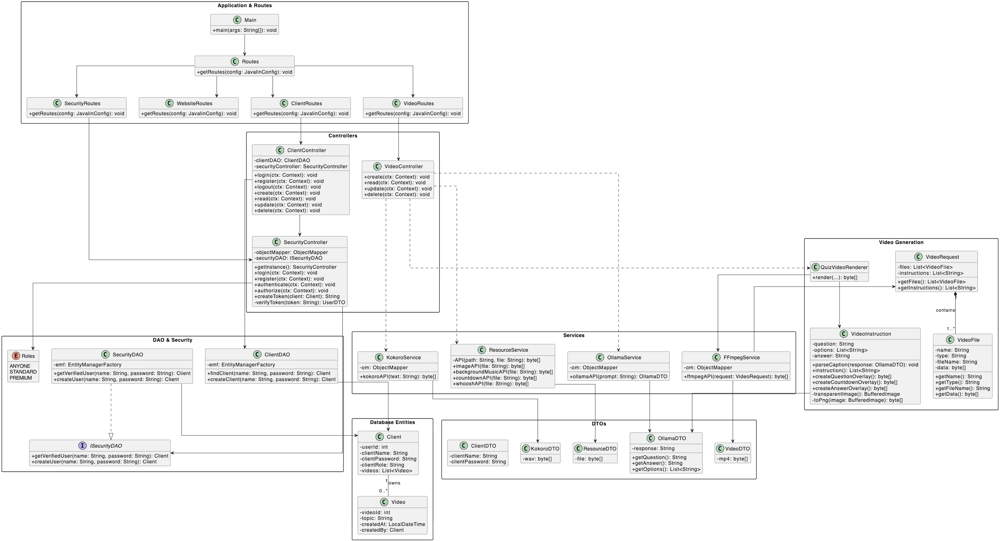
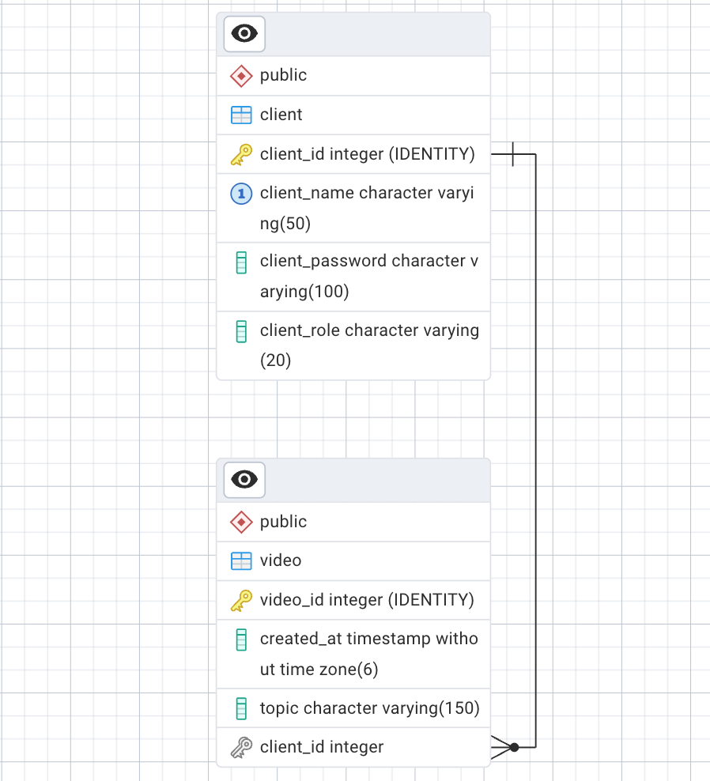

# Quiz Video Generator

## Vision
>This backend API allow users to create an account, log in, and generate quiz videos based on chosen categories. It also aims to let users access, watch, save, and download their generated videos.

---

## Links

Deployed application:  
<https://q4you.christiankenter.com>

Source code repository:  
<LINK>

Portfolio website:  
<https://portfolio.christiankenter.com>

---

# Architecture
### System Structure
This project uses a layered backend architecture consisting of:
- **Routes:** Defines API endpoints.
- **Controllers:** Handles HTTP requests and responses.
- **Services:** Handles video generation and external service communication.
- **DAO:** Manages database access.
- **Security:** Handles JWT authentication, password hashing, and user roles.

### Technologies Used
- Java and Javalin
- Maven
- JWT and BCrypt
- Ollama for quiz generation
- Kokoro for text-to-speech
- FFmpeg for video creation

---

## Class Diagram


---

## Key Design Decisions

- **Backend Framework:** I chose Javalin over Spring Boot because it is lightweight and provides the features needed for this API.


- **Database:** I chose PostgreSQL and Hibernate to store data and map Java objects to database tables.


- **Authentication:** I chose JWT over server-side sessions and BCrypt to securely hash passwords.


- **Video Generation:** I chose Ollama, Kokoro and FFmpeg instead of building quiz generation, text-to-speech and video rendering myself.


- **HTTP Communication:** I chose Java's built-in `HttpClient` over libraries like OkHttp because it covers the project's needs.


- **Project Structure:** I separated routes, controllers, services and DAO classes to keep responsibilities clear and make the code easier to maintain.

---

# Data Model

## ERD


---

# Important Entities

### Client
Represents a registered user of the system.

Fields:
- id
- clientName
- clientPassword
- role

### Video
Represents a generated quiz video.

Fields:
- Video data
- Video files
- Video instructions

### VideoFile
Represents an individual file used when creating a video, such as an image, audio file or overlay.

Fields:
- name
- type
- fileName
- data

### VideoRequest
Contains the files and instructions sent to the FFmpeg service to render the final video.

---

# API Documentation

### Generate Quiz Video

POST `/video/generate-video`
Generates a quiz video based on a selected category.
Request field:
- `category` – The category of the quiz.

### Register Client
POST `/auth/register`
Creates a new user account using JSON.
Request body:
```json
{
  "clientName": "john",
  "clientPassword": "secret"
}
```
---

# User Stories

- As a user, I want to register an account so I can use the system.


- As a user, I want to log in and receive an authentication token.


- As a STANDARD or PREMIUM user, I want to generate quiz videos by selecting a category.


- As a user, I want the system to generate a quiz video automatically.


- As a user, I want to receive the generated video so I can watch or save it.

---

# Development Notes

One of the main challenges was connecting the different services involved in video generation. Ollama, Kokoro, the resource server and FFmpeg each handle a different part of the process, so I had to ensure that data and files were passed correctly through the entire pipeline.

Another important learning experience was implementing JWT authentication and role-based access to protect the API endpoints.

I also learned how to set up CI/CD and deploy the project through an automated pipeline. This made development much easier.